

# SambaS3

*Play PS3 games on Android — a controller-first native UI for the RPCSX emulator.*

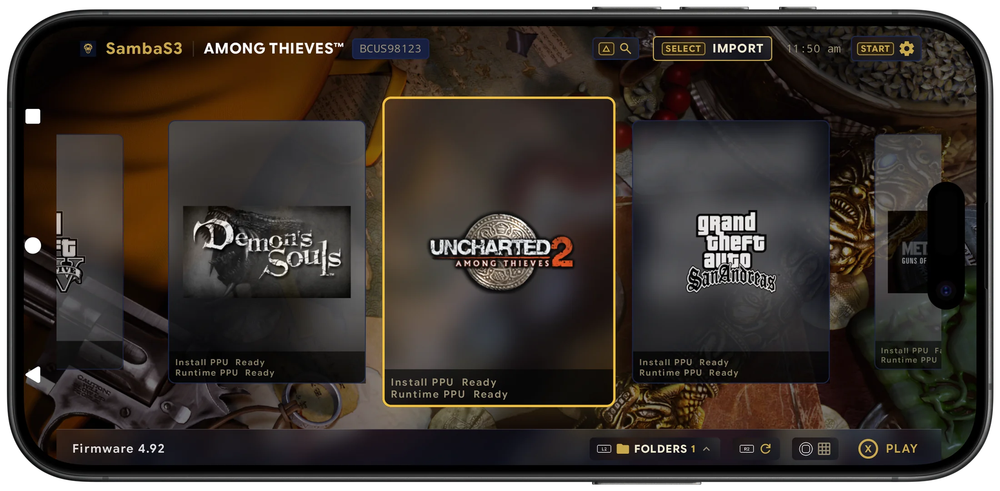

*Shot on a OnePlus 13R — live app UI, not a mockup.*

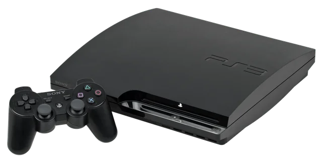 

[⬇ Android APK](https://github.com/zenithblue-oss/samba-s3/releases) · [Google Play](https://play.google.com/store/apps/details?id=com.zenithblue.sambas3) · [View Source ↗](https://github.com/zenithblue-oss/samba-s3)

> **Please don't ask for game or firmware links.** Piracy isn't allowed on our GitHub or Discord. SambaS3 ships with no games, no firmware and no keys — you bring your own dumps from hardware and discs you own.

## Index

- [Why SambaS3](#why-sambas3)
- [App Tour](#app-tour)
- [Setup](#setup)
- [Playable Games](#playable-games)
- [Specs](#specs)
- [Download](#download)
- [FAQ](#faq)

## Why SambaS3

*A console UI, not an emulator shell. Built for the couch and the controller.*

- ◫ **XMB Game Library** — horizontal carousel with cover art, serials and per-game config. Fully D-pad navigable.
- ⚙ **Runtime RPCSX Core** — the emulator core updates without reinstalling the app.
- ▣ **Turnip GPU Drivers** — bundled on Play Store builds; bring your own per game on standard builds.
- ✛ **Controller-First** — USB/Bluetooth pads with per-game mapping, plus a touch-overlay editor with live preview.
- ❚❚ **Save States + Pause Menu** — resume, states with thumbnails, screenshots and settings on Start/Options.
- ≡ **Deep Settings** — emulation, graphics, audio, patches, firmware, logs — every row pad-reachable.

## App Tour

*Real screenshots from a real device. Interactive version on the [website](https://zenithblue-oss.github.io/samba-s3/#showcase).*

| | |
|---|---|
| 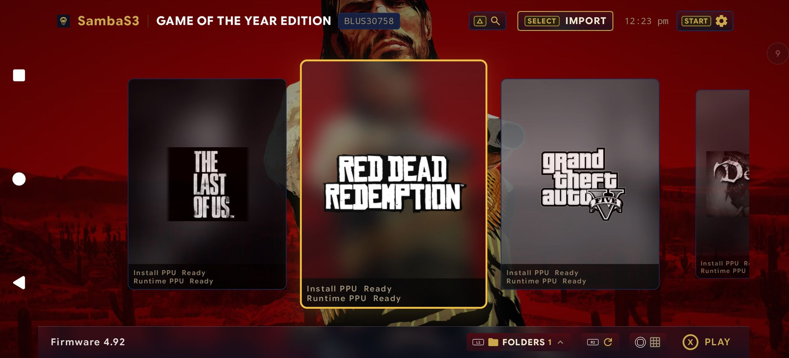 **Library** — Red Dead Redemption focused, PPU state on every card | 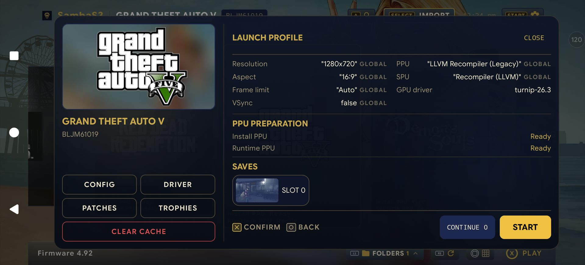 **Launch Profile** — per-game config, Turnip build, saves, START |
| 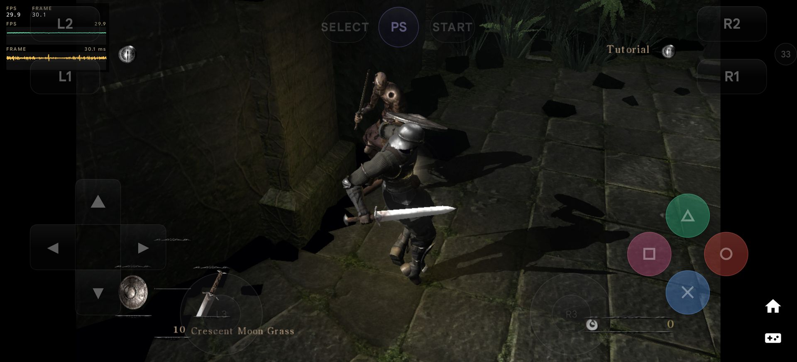 **In-Game** — Demon's Souls at 29.9 FPS with overlay + graphs | 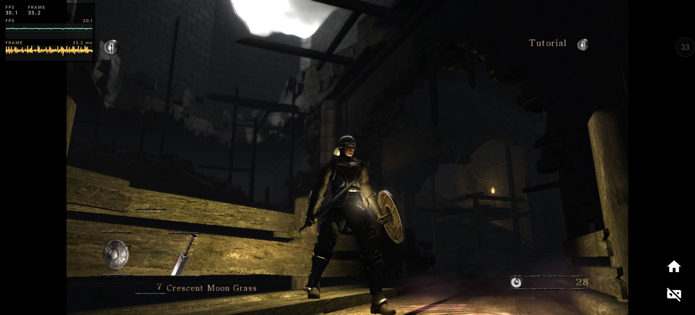 **Pad mode** — overlay off, clean fullscreen at 30.1 FPS |
| 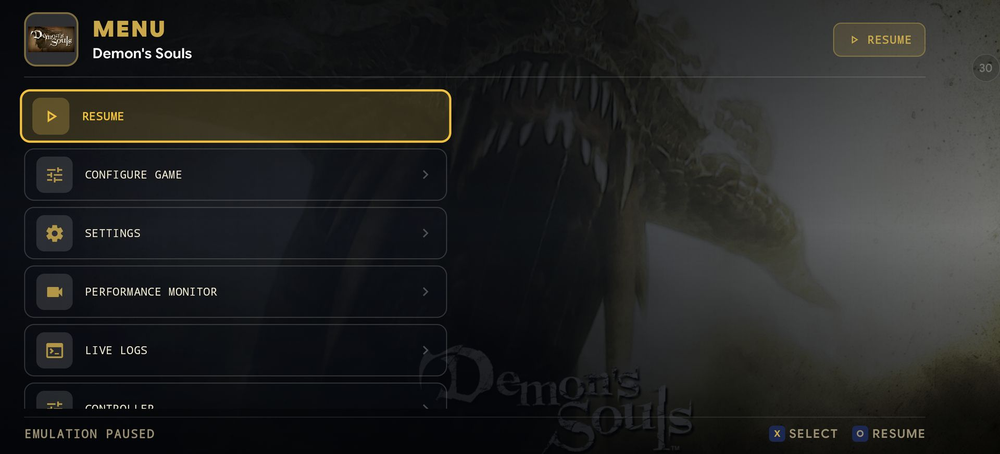 **Pause Menu** — resume, configure, live logs, all on pad | 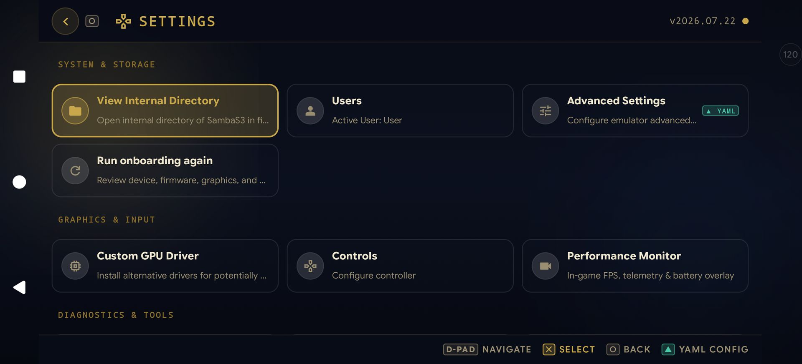 **Settings** — system, graphics and tools behind versioned YAML |
| 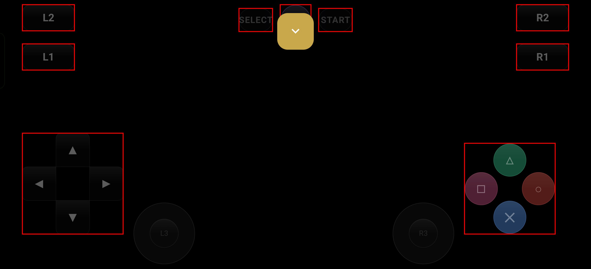 **Overlay editor** — drag, scale and preview touch controls | 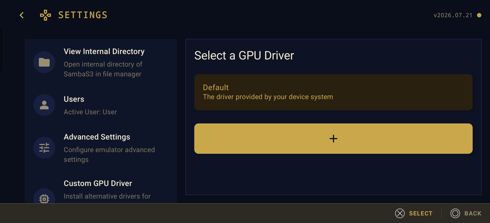 **Drivers** — bundled or imported Turnip, per game |

## Setup

1. **Install firmware** — dump `PS3UPDAT.PUP` from your own console and install it in-app.
2. **Import games** — add your own ISO, PKG or folder dumps with the `+` tile.
3. **Press ✕ and play** — boot from the carousel (✕ confirm · ○ back · △ game info · Start pause menu).

## Playable Games

*Framerates measured on-device, in-game. Cover art taken from inside each game's own disc image.*

| Game | Cover | Result |
|---|---|---|
| **Grand Theft Auto V** `BLJM61019` | 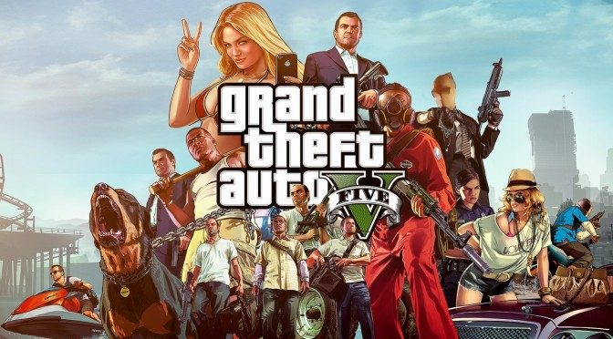 |  Boots and runs; heavy title, expect low framerates |
| **GTA San Andreas** `BLUS31584` | 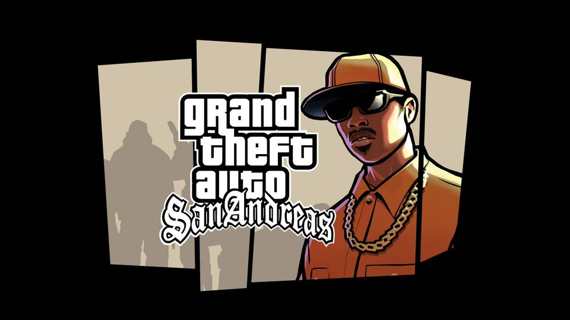 |  Smooth full-speed play; a great first boot test |
| **Demon's Souls** `BLUS30443` | 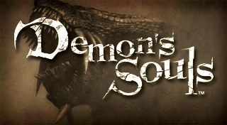 |  Full-speed with touch overlay or a pad |

**Tested on a OnePlus 13R** (CPH2691) — 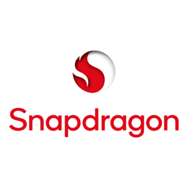 Snapdragon 8 Gen 3 ·  Adreno 750 ·  Mesa Turnip · 11 GB RAM · Android 16 · FW 4.92.

## Specs

Android 10+ · arm64 recommended (x86_64 works) · Vulkan-capable GPU · 6 GB RAM minimum, 8 GB+ for heavy games · your own ISO/PKG/folder dumps · controller or touch.

▲ Best results: Snapdragon 8-series · Turnip matched to the game · per-game config. Compatibility varies per title — emulation is experimental.

## Download

| Flavor | Good for | Get it |
|---|---|---|
| **Standard** (default) | Tuning your own GPU drivers per game | [⬇ Download APK](https://github.com/zenithblue-oss/samba-s3/releases) |
| **Play Store** | Zero setup, bundled drivers, auto-updates | [Get on Play](https://play.google.com/store/apps/details?id=com.zenithblue.sambas3) |

## FAQ

<b>What is SambaS3?</b>
 A native Android frontend for the RPCSX PS3 emulator — library, settings, firmware, drivers, controllers and save states in one controller-first app.

<b>Is it free?</b>
 Yes. Open source under GPLv2, no ads, no accounts.

<b>Where do games come from?</b>
 Your own dumps, from hardware and discs you own. We can't help with downloads.

<b>Which phone runs it best?</b>
 A recent flagship with Vulkan graphics and 8 GB+ RAM — Snapdragon 8-series with Turnip drivers is the sweet spot.

<b>Do I need a controller?</b>
 No, but everything is designed for one. USB/Bluetooth pads work, and there's an editable touch overlay.

<b>A game won't boot — what now?</b>
 Check firmware, try another GPU driver, reset that game's settings to default, and verify your dump. The app has a built-in log viewer — bring logs to Discord.

---

**SambaS3** · [Website](https://zenithblue-oss.github.io/samba-s3/) · [Releases](https://github.com/zenithblue-oss/samba-s3/releases) · [GitHub](https://github.com/zenithblue-oss/samba-s3) · [Discord](https://discord.gg/t6dzA4wUdG)

© 2026 SambaS3 contributors · GPLv2 · Not affiliated with Sony Interactive Entertainment

